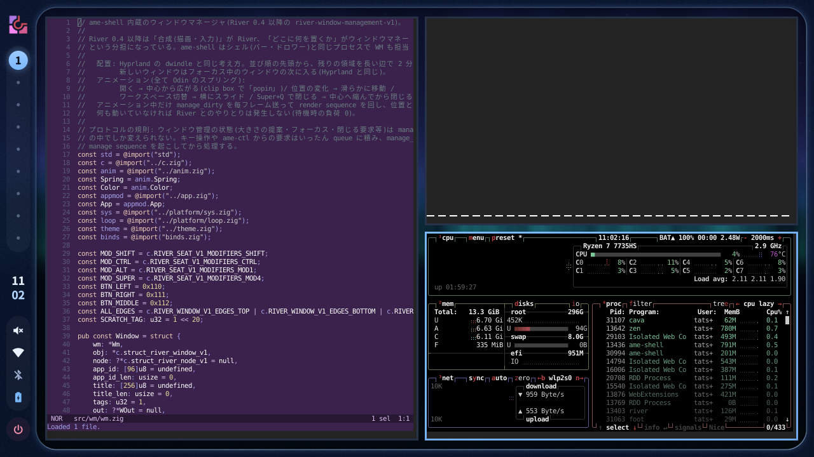
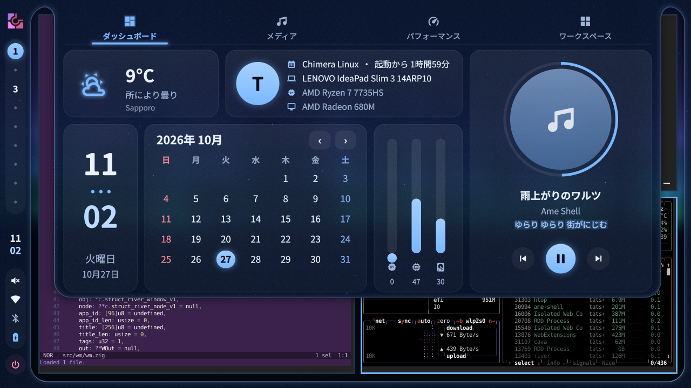
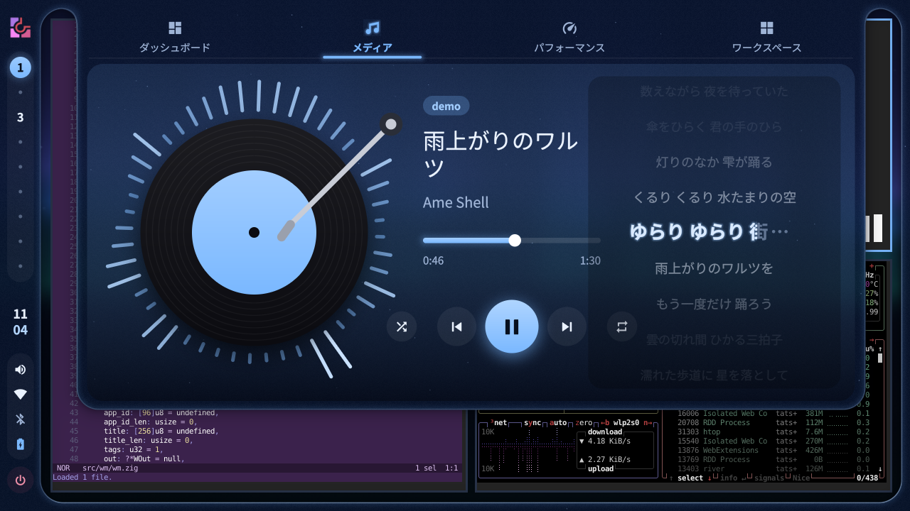
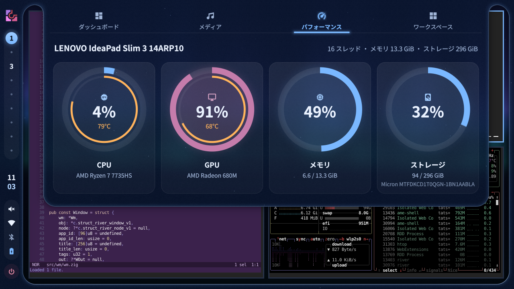
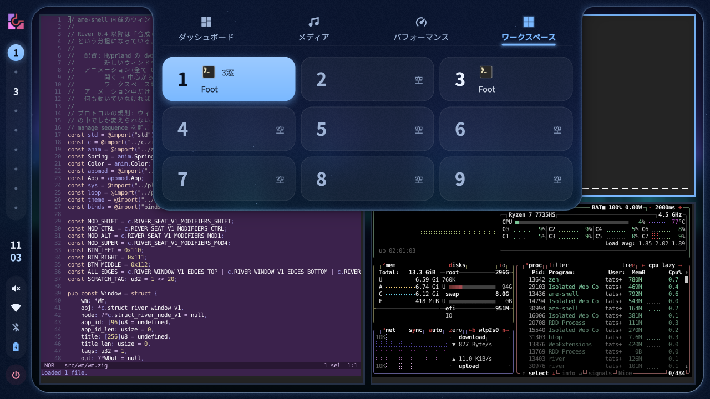
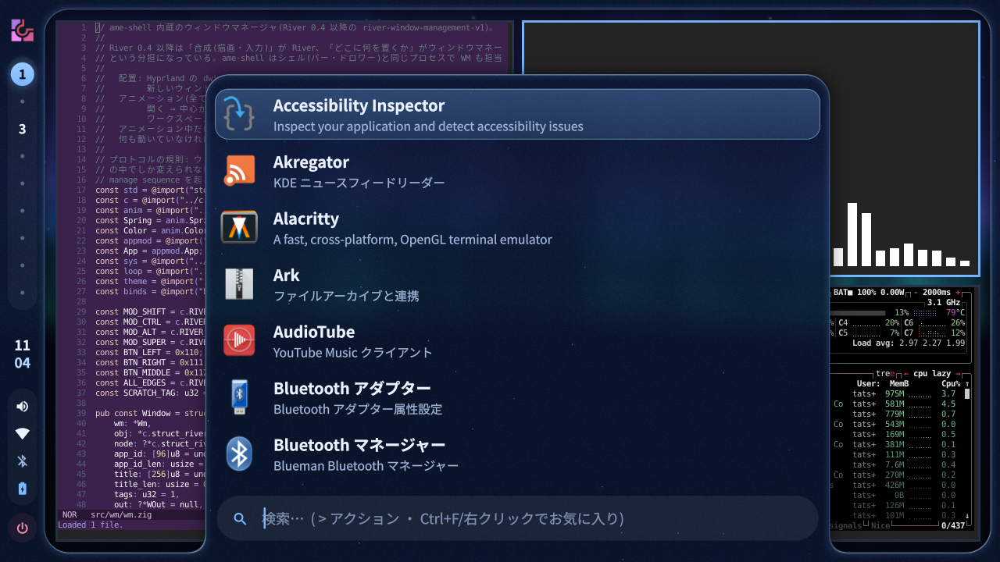
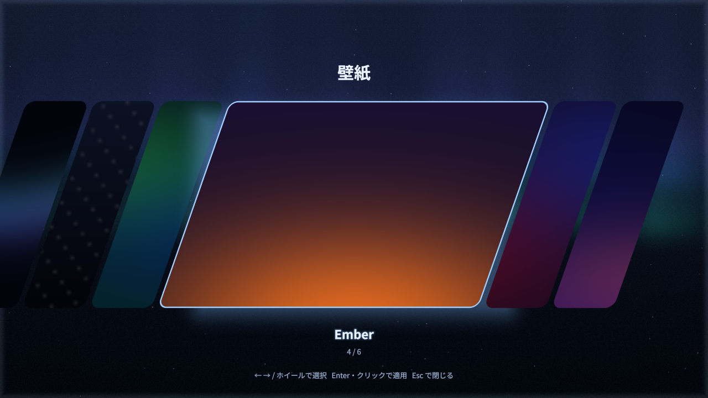
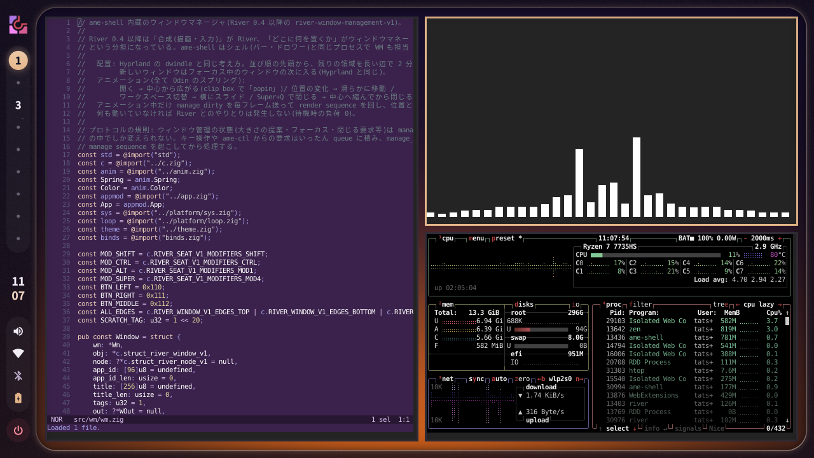
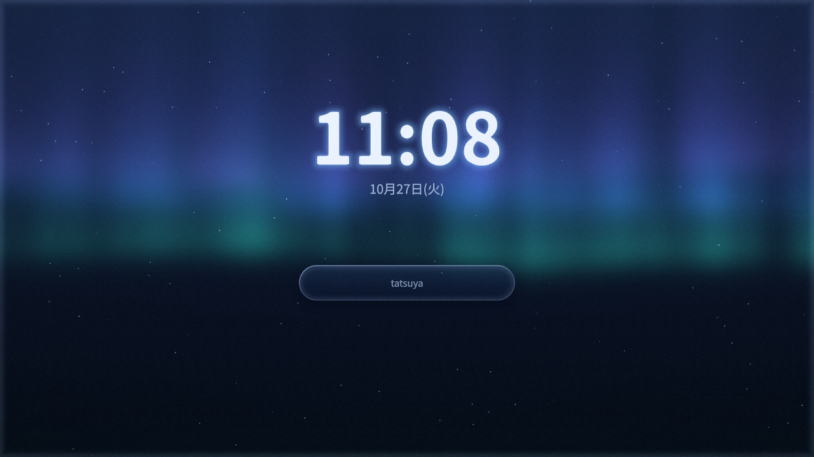

# ame-shell(雨)

[River](https://isaacfreund.com/software/river/)(Wayland コンポジタ)の上で動く、アニメーション重視のガラス調デスクトップシェル。
caelestia-shell・end-4・ilyamiro の雰囲気を目指しつつ、Quickshell / QML / Qt / Python / C++ を使わず **Zig・Odin・C・WebAssembly** だけで書いています。
Chimera Linux(musl + dinit)向け。SDDM から選べるセッションつき。



| | |
|---|---|
|  |  |
|  |  |
|  |  |
|  |  |

## 特徴

### 画面のふちから生えるドロワー(caelestia 風)
画面を細い枠が囲み、左に縦バー。枠の縁にカーソルを乗せると、そこからドロワーが「ニョキッ」と生えてきます(枠とドロワーは 1 つの SDF シェーダで smooth-min 融合しているので、付け根に丸みのある首ができる)。

- **上: ダッシュボード** — 4 つのタブ
  - ダッシュボード: 天気・機種/CPU/GPU 名・ユーザーの写真(クリックで選べる)・カレンダー・メディア
  - メディア: 回るレコードと、それを包む液体のスペクトラム(録音して ame-shell の中で FFT)、トーンアーム(再生中は針が盤面の溝に乗り、曲の進みに合わせて内側へ)、曲名・アーティスト・**アルバム名**、**同期歌詞**(今の行だけが 1 行ずつポンと出る。上・下をクリックで前・次の行へ、ホイールで前後の行を見る)
    - 歌詞の取り寄せ先: プレーヤー自身の歌詞ファイル → キャッシュ → music-tui の歌詞サーバ → LRCLIB → NetEase → 酷狗(Kugou)→ 曲名だけで LRCLIB。YouTube などの「【MV】アーティスト「曲名」」「〜 - Topic」といった書き方は、検索の前にアーティストと曲名へ整えます
    - プレーヤーが歌詞を持っている場合は `$XDG_RUNTIME_DIR/lyrics/<MPRIS のプレーヤー名>.lrc`(`[ti:]` `[ar:]` `[al:]` つきの LRC)に置くと、LRCLIB より優先して使います。曲が変わったら書き換えるか消してください
  - パフォーマンス: CPU / GPU / メモリ / ストレージの円グラフ(CPU・GPU は温度つき)
  - ワークスペース: 1〜9 と、それぞれで**開いているアプリのアイコンと名前**
- **下: ランチャー** — Super 単独・Super+D。ファジー検索、よく使う順、お気に入りの固定、全アイコンテーマ + SVG。`>` でアクション、`>壁紙` で壁紙
- **右: 音量・明るさ(OSD)/ 通知 / ユーティリティ / セッション / 通知センター**
- **縦バー** — タグ(液体のように伸びるインジケータ)・時計・音量・ネット・Bluetooth・電池。乗せると右にポップアウト
  - 音量のポップアウトで **出力先・入力先を切り替え**(再生中の音も移る)
  - ネット / Bluetooth をクリックすると **Wi-Fi・Bluetooth の設定パネル**(接続・切断・パスワード・スキャン・ごみ箱のボタンで Bluetooth の登録の削除(2 回押し)。外側をクリックで閉じる)。イヤホンは接続すると自動で音の出力先になる

### River 0.5 では本物のウィンドウアニメーション
River 0.5 は「描画は River、配置はウィンドウマネージャ」という分担です。ame-shell がそのウィンドウマネージャを兼ねます(`src/wm/`)。
- Hyprland の **dwindle** 配置、ワークスペース 1〜9、新しい窓はフォーカス中の窓の次へ
- **開く**: 中心から広がる / **移動・並べ替え**: なめらかに動く / **ワークスペース切替**: 横にスライド / **閉じる**: 縮んでから閉じる(すべてスプリング)
- 動いているときだけ毎フレーム更新し、止まっていれば River との通信も 0
- ame-shell を再起動しても窓のワークスペースは保たれる
- **浮いた窓は紙のようにたわむ**: つかんで動かすと、つかんだ所だけがカーソルに付いて行き、遠い所ほど遅れて付いてくる(窓の絵を ext-image-copy-capture で撮り、16×12 の網目で描く)。離すとすーっと元の形に戻る

River 0.3 のセッションでも、シェル部分(ドロワー・壁紙・ランチャーなど)はそのまま使えます。

### 壁紙と配色
- **ライブ壁紙**: シェーダで描くオーロラ / 雨、**GIF・MP4 などの動画**、画像。動画は libmpv(実行時に読み込み、ハードウェア復号)で再生し、libmpv が無い・再生できない・5 秒たっても映らないときは ffmpeg で再生します(VA-API で復号・縮小、使えなければ CPU。横 1280・30fps)。それでもだめなときは理由を通知します。`AME_VIDEO_BACKEND=ffmpeg` で ffmpeg に固定
- **壁紙ピッカー**(Super+Shift+W): 斜めのカードが並び、決定するとカードの位置から円・斜めワイプ・短冊で切り替わる
- **壁紙の置き場**: `~/Pictures/wallpapers`・`~/.config/ame-shell/wallpapers`・`~/.local/share/ame-shell/wallpapers`・`<prefix>/share/ame-shell/wallpapers`(同じ名前は 1 つにまとめる)。ame-update は、追加の壁紙を非公開リポジトリ(`AME_WALLPAPERS_REPO` で変更、空で無効)から取ってきます。GitHub にログインしていない場合は案内を出すだけです(`gh auth login && gh auth setup-git`)
- **配色は壁紙から自動**: 壁紙の一番鮮やかな色からアクセント、ガラス・文字色も合わせてなめらかに遷移。再生中はアルバムアートの色に。くすんだ緑や、エラーと紛らわしい赤は避ける
- **エラーは赤**: Wi-Fi の接続失敗などでは枠の縁が一瞬赤く光る
- **ガラス**: 壁紙を dual Kawase でぼかし、パネルは真後ろをサンプル(屈折・色収差・ハイライト)

### そのほか
- 通知サーバ内蔵(`org.freedesktop.Notifications`。他のデーモンが動いていれば譲る)
  - 電池の残量が少ないとき、充電器の抜き差し(満充電まであと何分・何時ごろ)、USB 機器・USB メモリ・SD カードの抜き差し(名前・容量・ラベル)も通知
- **録画**(ユーティリティの録画ボタン): wf-recorder で `~/Videos` に保存。**PC で鳴っている音も一緒に**録る(PipeWire は既定の出力、PulseAudio は `<出力>.monitor`)
- **スクリーンショット**: grim / slurp / wl-copy を使わず ame-shell が自分で撮る(ext-image-copy-capture、PNG は自前のエンコーダ、クリップボードは ext-data-control)
- **ハンド操作**(ユーティリティの「ハンド操作」ボタン・`ame-ctl hand toggle`・設定 `hand { enabled on }`。既定はオフ): カメラに映った手の動きでカーソルと窓を操作します
  - 指さすとカーソルが指先に付いて動き、窓のフォーカスも移る / **つまむ**と短くでクリック、つまんだまま動かすと窓をつかんで移動、**持ったまま手を近づける・遠ざけるとズーム** /
    **手を払う**と隣のワークスペース / **指の本数**を示して止めるとその番号へ / **開いた手を止める**と手のメニュー(ランチャー・ダッシュボード・全画面・浮かせる・大きく・小さく・スクショ・閉じる・ワークスペース 1〜9)/ **握りこぶし**で閉じる。操作のたびに水の波紋、カーソルの後ろには船の航跡のような V 字の波
  - 手の認識は MediaPipe の手のモデル(Apache-2.0、約 8MB。初めてオンにしたときに `~/.local/share/ame-shell/models` へ取ってくる)を、**Zig で書いた推論エンジン**(別のリポジトリ [ame-hand](https://github.com/TatsuyaM2667/ame-hand)。ame-shell 側は River の操作につなぐ `src/hand/hand.zig`)で動かします。C++・Python・OpenCV は使いません
  - カメラは V4L2 を直接(FreeBSD は webcamd)。オンの間だけ CPU を 1 コアの 10〜20% ほど使い、オフにするとカメラ・スレッド・モデルのメモリを全部返します
  - ame-shell が WM を兼ねるセッション(River 0.5。FreeBSD は常にこれ)では窓そのものをつかんで動かし・ズームします。River 0.3 のセッション(Chimera・Arch で内蔵 WM を使わないとき)では、ワークスペース・閉じる・全画面・浮かせる・大きく/小さく を riverctl と同じ命令で行い、つまんで動かすのは左ボタンのドラッグになります
- **ホーム画面の曲のウィジェット**: ロック画面と同じ曲のカードを、デスクトップの四隅のどこかに置く(同期歌詞つき)(窓の下。ドラッグで近い隅へ動かせ、覚える。`ame-ctl widget music <隅>`、`music-widget { corner … }`)
- **ロック画面**(Super+L、ext-session-lock + PAM。iOS / iPadOS のロック画面のような作り、`src/lockui.zig`):
  - 眺める画面: くっきりした壁紙(オーロラ・雨はロック中も動き続ける)の上に日付・特大の時計・電池、
    再生中の曲(右下の小さなカード。ジャケットを押すと、iPhone / iPad のように真ん中の大きなジャケットとその色の背景に広がる: 回るレコードと液体のビジュアライザー、進み具合(クリック・ドラッグで移動)、前・再生・次のボタン、音量のつまみ(ドラッグ・ホイール、スピーカーで消音)。音量・曲送りのキーもそのまま効く。歌詞はダッシュボードと同じ見せ方で上に浮かぶ)、
    ロック中に来た通知(新しい順に重なり、押すと広がる)、光が流れる「解除するには…」とホームバー
  - キーかクリックで入力画面へ: 背景がぼけて時計が小さく上へ、写真・名前・ガラスの入力欄。Esc か 12 秒で戻る
  - 解除すると**水の波紋**が中心から広がり、波が通り過ぎた所からデスクトップが透けて見える(ロック画面の最後の絵を写したオーバーレイを出してからロックを外す)
  - **顔認証**(ランチャーの「顔を登録」か `ame-ctl face enroll` で、パスワードで本人を確かめてから登録): ロック画面を触った時だけ(パスワードと同じ)カメラで顔を確かめてロックを外す。ログイン画面(greetd)でも使える(自作の PAM モジュール `pam_ame_face.so`。Linux と FreeBSD)。パスワードはいつでも使える
    - 照合は厳しめ: 赤外線カメラのみ(`require_ir`)、登録した顔の近い 2 つとの平均が cos ≥ 0.6 で 3 コマ続けて一致、続けて 3 回失敗したらパスワードで外すまで使わない
    - 赤外線カメラ(GREY を出すもの)でだけ登録・照合する(スマホの画面は赤外線では真っ暗に写る)。赤外線では顔が照明で十分明るいことも確かめる
    - 顔の検出は MediaPipe の BlazeFace、顔の特徴は OpenCV Zoo の SFace(どちらも Apache-2.0。初めて登録するときに取ってきて SHA-256 を確かめる)。ONNX を読むところも推論も**自作**(別のリポジトリ [ame-face](https://github.com/TatsuyaM2667/ame-face)、手の認識と同じエンジン)。C++・Python・OpenCV は使わない
    - 登録した特徴は `~/.local/share/ame-shell/face.bin`(本人だけが読める)。画像は残さない。顔認証はパスワードより弱い(赤外線で印刷した写真・双子)ので、要らなければ `face { enabled off }`
- WASM ウィジェット(保存すると状態を保ったままホットリロード)
- `ame-ctl` でシェルを操作(キーバインドやスクリプトから)

## インストール

```sh
git clone https://github.com/TatsuyaM2667/ame-shell && cd ame-shell
sh install.sh            # 全ユーザー用(/usr/local + SDDM のセッション)。root 権限は doas / sudo で自動的に
sh install.sh --user     # 自分だけ(~/.local)。root 不要。SDDM には出ないので TTY から ame-session --river5 で起動
sh install.sh --uninstall [--user]
```

`install.sh` が依存パッケージ(Chimera Linux は apk、Arch 系は pacman で自動。他のディストリは足りないものを表示)、Zig 0.13、Odin、River(無ければ River 0.5 をソースから)、ame-shell のビルドとインストールまで行います。
どのユーザーが実行しても構いません。doas / sudo が使えない人は自動で `--user` になります。全ユーザー用では、自分でビルドした River 0.5(`~/.local/opt/river-0.5`)も `/usr/local/opt` にコピーされ、他のアカウントからも River 0.5 のセッションが使えます。
端末は ghostty(無ければ foot)。下の「端末とシェル」を参照。

### Chimera Linux(新規インストールから)

Chimera のリポジトリには River 0.3 が無いので、`install.sh` が River 0.5 をソースからビルドし、ame-shell がウィンドウマネージャを兼ねるセッション(「Ame Shell」)だけを入れます。

1. 一般ユーザー(wheel グループ、doas が使える)でログインし、ソースを取ってくる
   ```sh
   doas apk add git
   git clone https://github.com/TatsuyaM2667/ame-shell && cd ame-shell
   ```
2. `sh install.sh` を実行する。次のことを順に行います
   - **パッケージ**(`doas apk add`): ビルドに要るもの(clang・llvm-devel・linux-headers・pkgconf・wayland / mesa / libdrm / xkbcommon / freetype / harfbuzz / fontconfig / dbus / linux-pam の -devel)、
     River 0.5 のビルドに要るもの(wlroots0.20-devel など)、動かすのに要るもの(greetd・foot・mesa-dri・polkit・pipewire・wireplumber・libpulse-progs・swaylock・brightnessctl・util-linux-rfkill・networkmanager・bluez・thunar・tumbler・xdg-desktop-portal(-gtk・-wlr)・fonts-noto-sans-cjk-otf・fonts-nerd-jetbrains-mono・fonts-nerd-symbols-only・adwaita / hicolor のアイコンテーマ)。
     どれかが入らないとそこで止まります(足りないまま進めて、スクショや波形が動かないことが無いように)
   - Zig 0.13 と Odin、River 0.5 のビルド、ame-shell のビルドとインストール
   - **インストール後の設定**(1 つずつ `[y/N]` で確認。`--yes` で全部、`--no-setup` で何もしない):
     video・input グループへの追加 / networkmanager・bluetoothd を次の起動から有効に / ログイン画面を ame-shell(greetd)に /
     wheel グループが NetworkManager を操作できる polkit のルール(`/etc/polkit-1/rules.d/50-networkmanager.rules`。無いと Wi-Fi パネルから接続できません)
   - **音のユーザーサービス**: pipewire・pipewire-pulse・wireplumber が有効か確かめ、確認してから `dinitctl --user enable` する
3. 最後の確認結果に `WARNING` が無いことを見て、再起動する。ame-shell のログイン画面(ロック画面と同じ見た目)が出ます

確認結果は、TTY(`TERM=linux`)では日本語が豆腐になるので英語で出します(`AME_ASCII=1` でも英語)。断った設定は最後に「あとで root で行うコマンド」として表示します。
インストールの中身だけを確かめるには `sh session/install-session.sh --dry-run`(何も書き込みません)。

**SDDM と、そのために入った KDE Plasma を消す**: ログイン画面は ame-shell(greetd)なので SDDM は要りません。Chimera の sddm は、既定のテーマ(plasma-desktop)とコンポジタ(kwin)のために KDE Plasma 一式(800 以上・約 2.5GB)を引き込んでいます。
ログイン画面を ame-shell にした後(`sh install.sh` の確認、または `doas sh scripts/greeter-setup.sh`)なら、次で消せます(Dolphin・Konsole・Okular・Kate なども消えます。ファイルマネージャは thunar):
```sh
# ame-shell が使うもの(KDE と一緒に入っていたもの)は残すよう明示する。'!sddm' は「sddm を入れない」の指定
doas apk add greetd greetd-dinit thunar tumbler ffmpeg mpv-libs libpulse-progs xwayland upower power-profiles-daemon '!sddm'
```
消す前に `apk add --simulate …`(同じ引数)で消えるものを確かめられます。SDDM をまた入れるときは `doas apk del '!sddm'` で指定を外してください。

### Arch Linux
`sh install.sh` が Arch(と EndeavourOS / Manjaro など Arch 系)を見つけると `scripts/install-arch.sh` を使います。River 0.5・Odin・wlroots 0.20 も公式リポジトリにあるので、pacman で入れて(AUR は使いません)、sddm・NetworkManager・bluetooth を有効にし(ほかのログイン画面が有効ならそのまま)、ame-shell をビルドしてインストールします。Zig だけは 0.13 が必要なので公式の配布物を `~/.cache` に取ってきます。
Bluetooth のイヤホンの音には `pipewire-audio`、バーのアイコンには `ttf-nerd-fonts-symbols` が要ります(どちらもインストーラが入れます)。PipeWire のユーザーサービスは `systemctl --user` で確かめます。

### 画面の拡大率・端末
- **拡大率は自動**(River 0.5 のセッション、`wlr-randr` を使用): 画素の細かさを作者の環境(14 インチ 1920x1200、拡大率 1)と比べて 0.25 刻みで決めます。ふつうの画面は 1 のまま、14 インチ 2880x1800 なら 1.5、13 インチ 4K なら 2。
  自分で決めるときは `~/.config/ame-shell/output-scale` に `1.5` や `eDP-1 1.5`(画面ごと)、`off` で自動設定なし。
- **端末(ghostty)とシェル(zsh)**: Super+Return で `ame-terminal` が ghostty(ame-shell と同じ Zig 製)を開きます。無ければ foot。
  - ghostty は Arch・FreeBSD ではパッケージ、Chimera はパッケージが無いので `install.sh` が公式のソースから Zig 0.17 でビルドします(GTK4・libadwaita の開発ファイルを入れて。失敗しても foot で続けます。`--no-ghostty` で飛ばす)
  - ghostty の設定: 自分の `~/.config/ghostty/config` が無ければ ame-shell のもの(`data/ghostty/config`: 夜空の紺に半透明、JetBrainsMono Nerd Font、ame の 16 色、タイトルバーなし、2 つ目からの窓はすぐ開く)
  - 端末の中のシェルは zsh(ログインシェルは変えません)。自分の `~/.zshrc` が無ければ ame-shell の設定(`data/zsh/.zshrc`): 2 行のプロンプト(場所・git のブランチと状態・かかった時間・終了コード・時刻)、矢印で選べる補完、↑↓ で入力中の文字から始まる履歴、灰色の候補(zsh-autosuggestions)、色分け(zsh-syntax-highlighting)、fzf(Ctrl+R)・zoxide(`z`)・eza(アイコン付きの `ls`)。足したい設定は `~/.config/ame-shell/zshrc.local` に
  - 開くと最初に `fastfetch` を表示します(`AME_FASTFETCH=0` で無効)
  FreeBSD では、インストーラと ame-update が `~/.config/foot/foot.ini` と `~/.config/fastfetch/config.jsonc`(いつもの大きいロゴ)をこの設定で上書きします(元のファイルは `*.ame-bak`)。
- **日本語入力(fcitx5 + Mozc)**: Chimera には Mozc のパッケージが無く、FreeBSD も quarterly に無いことがあるので、`sh install.sh --mozc` でソースからビルドして入れます(10〜20 分。`scripts/build-mozc.sh`)。Arch は pacman で入ります
- カーソルは未設定なら 24px(Adwaita)。
- **タッチパッド**: タップでクリック(設定 `shell { tap-to-click on|off }`、River 0.5 のセッション。変更はログインし直すと反映)。
  FreeBSD はインストーラが I2C(ig4・iichid・hmt)と PS/2(psm の Synaptics / Elantech)のドライバを設定します。後からは `doas sh scripts/freebsd-touchpad.sh`(再起動後に有効)、状態の確認は `sh scripts/freebsd-touchpad.sh --check`。
- **Bluetooth(FreeBSD)**: インストーラと ame-update が、内蔵アダプタのファームウェア(Realtek: rtlbt-firmware / Intel: iwmbt-firmware)・ng_ubt・hcsecd / sdpd / bthidd を設定します。後からは `doas sh scripts/freebsd-bluetooth.sh`、確認は `--check`。機器のペアリングは今のところ端末で `doas bluetooth-config scan`(マウス・キーボード)。
- **無線のブロック解除**: Linux ではセッションの開始時に `rfkill unblock all`(と `bluetoothctl power on`)。ログイン直後は `/dev/rfkill` の権限がまだ付いていないことがあるので、裏で数秒おきに試します。Bluetooth の電源を設定パネル・サイドバーから入れるときも、先にブロックを外します。
- **ログイン画面**: ame-shell 自身が描く(greetd + `ame-greeter`、`src/greeter.zig`)。**ロック画面と同じ見た目と動き**で、SDDM は要りません。
  - greetd が greeter 用のユーザー(Chimera: `_greetd`)で River 0.5 + ame-shell をログイン画面のモードで起動し、パスワードが合うと greetd がセッション(既定は「Ame Shell」)を始めます
  - 写真の左右の ‹ › でユーザー、左下でセッションを切り替え、右下に再起動・電源オフ。最後にログインした人が最初に出ます
  - 背景と写真は、ユーザーごとの置き場 `/var/lib/ame-shell/greeter/<ユーザー>`(FreeBSD は `/var/db/…`)から。ame-shell が起動したとき・壁紙を変えたとき・ロックしたときに、壁紙(画像なら絵、オーロラ・雨なら種類だけ)・ぼかした背景・写真・アクセント色をそこへ書きます(root は要りません。この置き場は誰でも読めます)
  - 入れ方: `sh install.sh`(インストール後の設定で確認)、または `doas sh scripts/greeter-setup.sh`(`--dry-run` で内容だけ表示)。`/etc/greetd/config.toml` を書き換え(元は `.ame-bak`)、次の起動から sddm の代わりに greetd を使います
  - ログイン画面が出ないときは TTY(Ctrl+Alt+F2)でログインして `doas sh scripts/greeter-setup.sh --undo`(SDDM に戻す)。ログは `/var/lib/greetd/ame-greeter.log`
  - 試す: `AME_GREETER=1 AME_GREETER_FAKE=1`(パスワード `ame` で成功したことにする)でネストした River の中に出せます
- **SDDM を使う場合**(FreeBSD など): ロック画面と同じ見た目の SDDM のテーマ(`data/sddm/ame`)も用意しています。
  - **背景・写真・アクセント色は ame-shell が書き出す**: インストーラがユーザーごとの置き場 `/var/lib/ame-shell/greeter/<ユーザー>`(FreeBSD は `/var/db/…`)を作り、ame-shell が起動したとき・壁紙を変えたとき・ロックしたときに、ぼかした壁紙(ロックしたときはロック画面の背景そのもの)・ユーザーの写真・アクセント色をそこへ書きます。root は要らず、次のログイン画面から反映されます。この置き場は誰でも読めます(ぼかした壁紙と写真が入るため)。
  - まだ書き出していないときは、壁紙の画像(動画なら 1 コマ目)をぼかしたもの、オーロラ・雨ならオーロラ風の背景。
  - **SDDM の設定を上書き**: `/etc/sddm.conf.d/zz-ame.conf`(既定と他の conf.d より後に読まれる)でテーマを ame に。`/etc/sddm.conf` にテーマなどの指定があれば、元を `.ame-bak` に残してその行を無効にします。
  - **軽いコンポジタ**: Chimera の既定ではログイン画面が kwin_wayland の上で動き重いので、weston があれば `weston --shell=kiosk` に替えます(キーボード配列は `~/.config/ame-shell/xkb-layout` → X11 の設定 → `localectl` の順に渡す)。
  - 入れ方: `sh install.sh`(インストール後の設定で確認)、または `doas sh scripts/sddm-theme.sh`(`--dry-run` で内容だけ表示、`--no-compositor` でコンポジタは変えない)。FreeBSD はインストーラと ame-update が入れます。元に戻すのは `sh install.sh --uninstall`。
  - ログイン画面が出なくなったときは、TTY(Ctrl+Alt+F2)でログインして `doas rm /etc/sddm.conf.d/zz-ame.conf` で元の設定に戻ります。
  - SDDM のテーマは QML でしか書けないため、ここだけ QML を使っています。

### アップデート(ame-update)

```sh
ame-update            # OS のパッケージ(FreeBSD は pkg、Chimera は apk)→ ame-shell(git pull → ビルド → インストール)→ 再起動
ame-update --check    # 更新があるかを見るだけ
ame-update --no-pkg   # ame-shell だけ(--no-self でパッケージだけ)
```

ランチャーで `>` → 「アップデート」からも実行できます(端末が開きます)。root が必要な作業は doas → sudo → su の順に使える方で行います。
ソースに手元の変更があるときは `git pull` をせず、今のソースでビルドします。動いている ame-shell は新しい版で起動し直します(窓とワークスペースはそのまま)。

### FreeBSD(14 / 15、amd64)

```sh
pkg install -y git && git clone https://github.com/TatsuyaM2667/ame-shell && cd ame-shell
sh install.sh            # = sh scripts/install-freebsd.sh(完全自動)
```

パッケージ(River・SDDM・Xorg・Wayland・フォント・日本語入力)、GPU ドライバ(amdgpu / i915kms / nvidia-drm を自動判別)、dbus / seatd / sddm の有効化、video グループ、
Zig 0.13 と Odin のソースからのビルド(FreeBSD 向けの配布物が無いため、30 分〜1 時間ほど)、ame-shell のビルドとインストールまで行います。終わったら再起動すると SDDM に「Ame Shell」が出ます。
オプション: `--no-gpu`・`--no-ja`・`--no-super-tap`・`--jobs N`・`--yes`(`sh scripts/install-freebsd.sh --help`)。

FreeBSD での違い:
- FreeBSD の `river` パッケージは 0.4 以降なので、ame-shell がウィンドウマネージャを兼ねるセッション(ウィンドウアニメーションつき)だけになります
- 電池・CPU・メモリ・温度は sysctl、音量は PipeWire が無ければ `mixer(8)`、明るさは `backlight(8)`、機種名は SMBIOS(kenv)から
- ロック画面(Super+L)は Linux と同じ ame-shell のもの。FreeBSD の pam_unix は root でないとパスワードを照合できないので、照合だけを小さな setuid の補助 `ame-auth`(`/usr/local/libexec/ame-shell/ame-auth`、PAM のサービスは `/usr/local/etc/pam.d/ame-shell`)に任せます。インストーラ(root で `sh install.sh`)が入れます。`ame-auth` が無いときは setuid の `swaylock` を使います
- 音は PulseAudio(セッションの開始時に動いていなければ起動)。充電の残り時間は `acpiconf -i 0`、USB メモリ・SD カードの通知は devd から
- Wi-Fi のパネルは wpa_supplicant(`wpa_cli`)、Bluetooth は netgraph + hcsecd。Bluetooth の機器の追加は root の `bluetooth-config` なので端末で行います(BlueZ が無いため、Linux のようなパネルからのペアリングはできません)
- ログイン画面は SDDM(greetd が FreeBSD の quarterly に無いため。テーマはロック画面と同じ見た目)

### 手動でビルドする

必要: Zig 0.13、Odin、wayland-scanner、wayland / EGL / GLESv2 / xkbcommon / freetype / harfbuzz / fontconfig / dbus の開発ファイル(FreeBSD は加えて libepoll-shim・libinotify)。
実行時に使うもの: `wpctl` / `pactl`(PipeWire)・NetworkManager と BlueZ(コマンドは使わず D-Bus で直接)・`rfkill`・`curl`・`xdg-desktop-portal` と `-gtk`(ユーザーの写真を選ぶ画面)・`libmpv`(動画壁紙、任意)・`ffmpeg`(動画のサムネイル、任意)・`wf-recorder`(録画、`~/Videos` に保存、任意)。
フォント: 日本語(Noto Sans CJK)と Nerd Font のアイコン(JetBrainsMono Nerd Font か Symbols Nerd Font)。無いと起動時にログ(`session.log`)へ入れるパッケージ名を出します。
音を拾えない(PipeWire / PulseAudio が無い)ときはメディアの波形の場所に理由を表示します。cava・playerctl・grim・slurp・wl-clipboard・nmcli・bluetoothctl は使いません(すべて ame-shell の中で行います)。もう要らないパッケージや KDE の古い設定は `sh scripts/cleanup-old.sh` で消せます。

```sh
zig build -Doptimize=ReleaseFast     # zig-out/bin/{ame-shell,ame-ctl,ame-auth}, zig-out/share/ame-shell/
zig build test
sh session/install-session.sh        # インストールだけ(--user / --dry-run / --destdir DIR も可)
# Linux から FreeBSD 向けに試しビルド: zig build -Dtarget=x86_64-freebsd --sysroot <FreeBSD の root> --libc <libc.txt>
```

### セッション

SDDM に追加されるセッション:

| セッション | 内容 |
|---|---|
| **Ame Shell (River 0.5)** | ame-shell がウィンドウマネージャを兼ねる。ウィンドウアニメーションあり。River 0.5(`/usr/local/opt/river-0.5`・`~/.local/opt/river-0.5`・PATH の River 0.4 以降)|
| **Ame Shell** | River 0.3 + ame-shell(River 0.3 が入っているときだけ)|

River 0.3 が無いシステム(Chimera Linux・FreeBSD など)では、River 0.5 のセッションだけが「Ame Shell」という名前で入ります。
セーフモード(River 0.3 + foot だけ)は廃止しました。以前の版で入れた「Ame Shell (Safe Mode)」は、入れ直すと消えます。
`ame-session` は、頼まれた River が無ければもう一方(0.3 ⇔ 0.5)で起動します。

入るものは `/usr/local/share/ame-shell/installed-files`(自分用は `~/.local/share/ame-shell/installed-files`)に記録され、`sh install.sh --uninstall` で元に戻せます。
ログは `~/.local/state/ame-shell/session.log`。

インストールせずに試す(今のセッションの中にウィンドウとして開く):
```sh
PATH=$PWD/zig-out/bin:$PATH AME_SESSION_NESTED=1 session/ame-session --river5
```

### Bluetooth イヤホン(AirPods など)が繋がらないとき
`br-connection-refused` で繋がらない・すぐ切れる場合は、`doas sh session/bt-airpods-fix.sh` で BlueZ を従来の Bluetooth(BR/EDR)接続に切り替えてから、ペアリングし直してください(`--undo` で元に戻せます)。

設定パネルからのペアリングは、ブロック解除(rfkill)→ 電源 → ペアリング可 → エージェント(`NoInputNoOutput`)つきのペアリング → 信頼 → 接続 → 音の出力先の切り替え、の順に行います(BlueZ を D-Bus で直接。bluetoothctl は使いません。`src/platform/netdbus.zig`)。認証に失敗したら一度ペアリングを消してやり直します。
つながったのに音が出ないときは、パネルに理由が出ます(`pactl` が無い、PipeWire が動いていない、Bluetooth の音声のプラグインが無い: Arch は `pipewire-audio`)。

音が電話のようにガサガサになるのは、アプリがマイクを開いた瞬間に通話用(HFP、モノラル 16kHz)に切り替わるためです。設定パネルから接続すると、この自動切り替えを止めます(`wpctl settings --save bluetooth.autoswitch-to-headset-profile false`)。通話でイヤホンのマイクを使うときは、音量のポップアウトで入力をイヤホンに切り替えてください。

## キー操作(River 0.5 セッション)

| キー | 動作 |
|---|---|
| Super(単独で押して離す)/ Super+D | ランチャー |
| Super+Return / Super+T | 端末(ghostty。無ければ foot)|
| Super+A / Super+N / Super+U | ダッシュボード / 通知センター / ユーティリティ |
| Super+Escape | セッション(ロック・ログアウト・再起動・電源オフ。危険な操作は 2 回押し)|
| Super+L | ロック |
| Super+Shift+W | 壁紙ピッカー |
| Super+E | ファイルマネージャ(Thunar。ame-shell のセッションでは端末と同じ半透明のテーマ AmeGlass で開く。`AME_FILES_THEME=0` でいつものテーマ)|
| Super+Q / Super+F / Super+Space | 閉じる / 全画面 / フロート |
| Super+J・K / Super+Shift+J・K | フォーカス / 入れ替え |
| Super+Ctrl+H・L | 左右の比率 |
| Super+1〜9 / Super+Shift+1〜9 / Super+Alt+1〜9 | ワークスペース切替 / 窓を移動 / 窓を移動して自分も移る |
| Super+Ctrl+1〜9 | ワークスペースの表示を足す |
| Super+P / Super+Shift+P | スクラッチパッド |
| Super+ドラッグ(左 / 右)/ Super+中クリック | 移動 / 大きさ変更 / フロート |
| タイトルバーをドラッグ | 窓をタイルから外して浮かせる(ひと回り小さくなる)。浮いた窓は、つかんで動かすと紙のようにたわみ、離すとすーっと元の形に戻る(AME_WOBBLE=0 で無効)。浮いた窓は縁をドラッグで大きさを変更。縁(窓のすぐ外側)かタイトルバーのダブルクリック・画面の上の端へドラッグ・Super+Space でタイルに戻す |
| Print / Shift+Print / Super+Print | 範囲 / 全画面のスクリーンショット(~/Pictures/Screenshots + クリップボード)/ 全画面をクリップボードだけ。ame-shell が自前で撮る(止めた画面の上でドラッグ、Enter で全体、Esc でやめる)。ext-image-copy-capture の無い River 0.3 などでは grim・slurp・wl-copy を使う |
| 音量・明るさ・メディアキー | OSD つき |
| Super+Shift+R | ame-shell を読み込み直す(更新を入れた後に。窓はそのまま)|
| Super+Shift+E | セッションを終了 |

River 0.3 セッションのキーは `session/ame-river-init`(追加設定は `~/.config/ame-shell/river-extra.sh`)。

## 設定

`~/.config/ame-shell/config.ame`(無ければ `share/ame-shell/config.ame`)。**保存した瞬間に反映**されます。

```
shell {
  layout caelestia              // caelestia | classic(上部の横バー)
  ui-scale 1.25
  super-launcher on
  weather-location "Sapporo"    // 省略すると IP アドレスから推定
}
theme {
  auto-color on                 // 壁紙から配色を作る
  media-accent on               // 再生中はアルバムアートの色に
  blur 3
}
wallpaper {
  mode aurora                   // aurora | rain | image
  // image "~/Videos/rain.mp4"  // 画像・GIF・動画
  transition random             // ripple | circle | slant | shards | random
  fps 30
  battery-fps 12
}
```
全項目は `data/config.ame` を参照。

### 環境変数と自動起動(`~/.config/ame-shell/environment`・`autostart`)

| ファイル | 読むもの・時期 | 例 |
|---|---|---|
| `~/.config/ame-shell/environment` | `ame-session` がログインのたびに sh の `.` で読む。`export` した変数は River・ame-shell・すべてのアプリと D-Bus から起動されるものに渡る | `share/ame-shell/examples/environment`(`data/examples/environment`)|
| `~/.config/ame-shell/autostart` | River の init がセッションの開始時に 1 回実行する(画面と D-Bus の準備の後)。実行権限が無ければ `sh` で | `share/ame-shell/examples/autostart`(`data/examples/autostart`)|

```sh
mkdir -p ~/.config/ame-shell
cp /usr/local/share/ame-shell/examples/environment ~/.config/ame-shell/environment   # 日本語入力の変数など
cp /usr/local/share/ame-shell/examples/autostart ~/.config/ame-shell/autostart       # fcitx5 -d --replace など
```

例の中身(日本語入力): `XMODIFIERS=@im=fcitx`、`QT_IM_MODULES="wayland;fcitx"`、autostart で `fcitx5 -d --replace`。変更は次のログインから有効です。
`river-extra.sh` / `river5-extra.sh`(River の init が `.` で読む)も引き続き使えますが、アプリ全体に渡したい変数は `environment` に書いてください。

**Flatpak**: `ame-session` が `XDG_DATA_DIRS` に `~/.local/share/flatpak/exports/share` と `/var/lib/flatpak/exports/share` を足すので、Flatpak のアプリもランチャーにアイコンつきで出ます。

**ポータル**(ファイルを開く画面・画面共有): `ame-session` が `XDG_CONFIG_DIRS` の先頭に置く `share/ame-shell/xdg` に `xdg-desktop-portal/river-portals.conf` を入れています(既定は gtk、Screenshot と ScreenCast は wlr)。自分の `~/.config/xdg-desktop-portal/river-portals.conf` があればそちらが優先されます。
ユーザーの D-Bus はログアウトしても残るため、前のセッションのポータルが画面を出せないまま残ることがあります。River の init はセッションの開始時に自分のポータルを止めて、今の環境で起動し直します。

**ユーザーの写真**(ダッシュボード左上の丸): 押すと `~/Pictures` の画像が並びます。ほかの場所の写真は「ファイルから選ぶ…」(O キー、`ame-ctl avatar pick`)でファイル選択の画面から。`~/Pictures` に画像が無ければ、すぐにファイル選択の画面を開きます。

## ame-ctl

```
ame-ctl launcher toggle|open [検索語]|close
ame-ctl dashboard toggle|open|close|dashboard|media|performance|workspaces
ame-ctl network | bluetooth | wallpaper-picker | session | sidebar | utilities | close-all
ame-ctl volume up|down|mute|<0-100>      ame-ctl brightness up|down
ame-ctl wallpaper aurora|rain|<画像・GIF・動画のパス>
ame-ctl accent '#ff88aa'|reset           ame-ctl notify <テキスト>
ame-ctl workspace <1-9>                  ame-ctl window close|fullscreen|float|focus-next|…(River 0.5)
ame-ctl screenshot region|full|clip      ame-ctl avatar pick
ame-ctl media play-pause|next|previous    ame-ctl net wifi|saved|radio|ssid|bt|bt-devices
ame-ctl hand on|off|toggle|status        (ハンド操作)
ame-ctl face enroll|clear|status        (顔認証: 顔を登録・消す)
ame-ctl widget music <隅|on|off>       (ホーム画面の曲のウィジェット: top-left / top-right / bottom-left / bottom-right)
ame-ctl lock | reload | widgets reload | stats | restart | quit
```

## WASM ウィジェットを書く

`widgets/*.zig` を参照。`widgets/ame.zig`(SDK)の `rect/grad/glass/text/arc/art` で描画命令を積み、`ame.store` から時刻・システム・メディアの値を読みます。`zig build` で `share/ame-shell/widgets/*.wasm` に出力され、`~/.config/ame-shell/widgets/` に同名の `.wasm` を置くとそちらが優先されます。保存すると状態を保ったまま差し替わります。

## 既知の問題

- River 0.3 系のセッション(「Ame Shell」の River 0.3 版)は Chimera Linux では使えない(リポジトリに river 0.3 が無い)。Chimera では River 0.5 のセッションだけが入る。FreeBSD も同じ(river パッケージが 0.4 以降)。
- ウィンドウの開閉アニメーションは River 0.5 セッションのみ(River 0.3 には外から窓を動かす手段が無い)。ウィンドウ越しのガラスは未対応。
- ユーザーの写真を選ぶ画面は xdg-desktop-portal の実装(xdg-desktop-portal-gtk)が出すので、見た目は GTK のもの。
- River 0.3 では、ワークスペースごとのアプリ名は推測(River 0.3 は窓とタグの対応を外に出さない)。
- ランチャーの日本語入力(IME)とトレイは未対応。
- FreeBSD: Bluetooth の機器の追加は端末(`doas bluetooth-config scan`)。ログイン画面は SDDM。
- 動画壁紙は再生中に CPU 約 5%(720p)・メモリ +130MB 程度を使う。
- 詳細は `docs/blockers.md`、計測値は `docs/perf.md`。

## ドキュメントサイト

`site/` に、写真・動画・ブラウザで動くデモつきの詳しいドキュメント(docs・技術解説・ソースから自動生成する関数リファレンス・用語の Wiki・開発ブログ)があります。本文は Zig の WebAssembly(`site/src/main.zig`)が HTML にし、デモは ame-shell と同じ `anim/anim.odin` を WebAssembly にしたものを動かします。

```sh
zig build site                 # zig-out/site に作る
sh site/deploy.sh              # Cloudflare Pages に公開(curl だけ。CLOUDFLARE_API_TOKEN と CLOUDFLARE_ACCOUNT_ID が要る。--dry-run で送るものだけ表示)
```

## ドキュメント

`docs/architecture.md`(構成)・`docs/decisions.md`(設計判断と理由)・`docs/perf.md`(実測)・`docs/reference-analysis.md`(参考シェルの分析)・`docs/progress.md`(進捗)

## ライセンス

GPL-3.0(`LICENSE`)。同梱のサードパーティ: wasm3(MIT、`third_party/wasm3/LICENSE`)、stb_image(MIT / パブリックドメイン)、nanosvg(zlib)。`protocol/` の XML は各プロトコルのライセンスに従います。
スクリーンショットの壁紙はシェーダと ffmpeg で生成したもの、歌詞は説明用に書いたオリジナルです。
