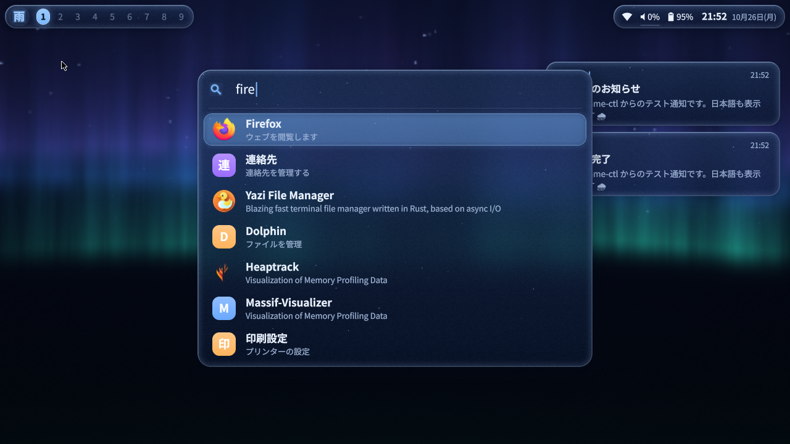
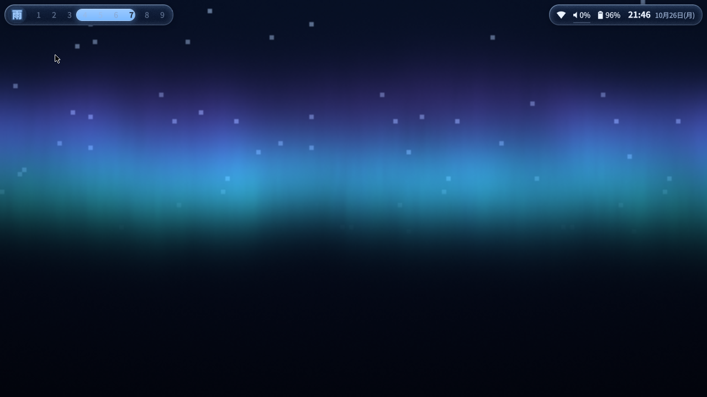

# ame-shell(雨)

River(Wayland コンポジタ)の上で動く、アニメーション重視のガラス調デスクトップシェル。
Quickshell / QML / Qt / Python / C++ を使わず、**Zig・Odin・C・WebAssembly** だけで書いています。
Chimera Linux(musl + dinit)向け。SDDM から選んでログインできるセッションつき。

| | |
|---|---|
|  |  |
|  |  |

## 何が入っているか

**レイアウトは 2 種類**(`shell { layout caelestia | classic }`、既定は caelestia):
- **caelestia**: 画面のふちを細い枠が囲み、左に縦バー。枠の縁にマウスを乗せると、そこからドロワーが「ニョキッ」と生えてくる(枠とドロワーは 1 つの SDF で smooth-min 融合しているので、付け根に丸みのある首ができる)。
  - 上の縁(中央): ダッシュボード(ダッシュボード / メディア(cava のスペクトラム)/ パフォーマンス / ワークスペース のタブ)
  - 下の縁: ランチャー(Super+D、または下の縁から上へドラッグ)。`>` でアクション、`>壁紙` で壁紙ピッカー
  - 右上: 通知 / 右の縁(中央): 音量・明るさの縦スライダー(OSD)/ 右下の角: ユーティリティ(Wi-Fi・Bluetooth・通知停止・スリープ防止・録画・スクショ・電源プロファイル)
  - 右: セッション(Super+Escape / 電源ボタン / 右の縁を左へドラッグ)、サイドバー=通知センター(Super+N / 右の縁を大きく左へドラッグ)
  - 縦バーの項目(時計・音量・ネット・Bluetooth・電池・ウィンドウ名)に乗せると、右へポップアウトが生える
- **classic**: 画面上部に浮かぶ横バーと、独立したパネル群(以下の説明)。

- **バー**: River のタグ 1〜9。選択インジケータは 2 本のスプリングで両端を動かし、移動中は液体のように伸びる。ウィンドウタイトルのクロスフェード、ネット/音量/バッテリー/時計。クリック・ホイールで操作。
- **ライブ壁紙**: シェーダで描くオーロラ / 雨(街のボケ + 雨筋 + 水たまりの波紋)/ 画像。切り替えは中心から広がる波紋のトランジション。バッテリー時は自動で FPS と解像度を下げる。
- **ガラス**: 壁紙を dual Kawase でぼかし、パネルは真後ろをサンプル。縁で屈折・色収差・ハイライト、微細なノイズとスパークル。
- **ランチャー**(Super+D): .desktop を Odin 製ファジーマッチで検索、結果は連鎖スプリングで順に出現。`>` で始めるとコマンド実行。よく使うアプリが上に来る。
- **通知**: `org.freedesktop.Notifications` を内蔵(他のデーモンが動いていれば譲る)。右上にカードが積まれ、ホバー中は消えない。
- **ダッシュボード**(Super+A / 時計クリック): **WASM ウィジェット**(時計・メディア・音量/明るさ/Wi-Fi/Bluetooth/通知停止・CPU/メモリ/温度・カレンダー)+ 通知センター。ウィジェットは保存すると状態を保ったままホットリロード。
- **メディア**: MPRIS。アルバムアートから Odin で主色を抽出し、テーマのアクセント色がその色へなめらかに変わる。
- **OSD**: 音量・明るさ。
- **ロック画面**(Super+L): ext-session-lock-v1 + PAM。認証できない構成ではロックしない(閉じ込め防止)。
- **ame-ctl**: Unix ソケットでシェルを操作する CLI。

**その後に追加したもの**:
- **River 0.5 セッション「Ame Shell (River 0.5)」**: ame-shell がウィンドウマネージャ(river-window-management-v1)を兼ねる。Hyprland の dwindle 配置、ワークスペース 1〜9、窓の開閉・移動・ワークスペース切替・閉じるのアニメーション(`src/wm/`)。River 0.3 のセッションもそのまま使える。
- **壁紙から配色を自動生成**: 壁紙の一番鮮やかな色からアクセント(くすんだ緑は避ける)、ガラス・文字色も合わせて滑らかに遷移。エラーは赤で、失敗したときは枠の縁が赤く光る。
- **ライブ壁紙に GIF / MP4**: libmpv を実行時に読み込み(dlopen)、ハードウェア復号した動画を壁紙に。
- **Wi-Fi / Bluetooth の設定パネル**、音量のポップアウトで**出力先・入力先の切り替え**。Bluetooth のイヤホンは接続すると自動で音の出力先になる。
- **ダッシュボード**: 機種・CPU・GPU 名、ユーザーの写真(クリックで選択)、同期歌詞つきのメディア、CPU/GPU/メモリ/ストレージの円グラフ、ワークスペースごとのアプリ名。
- **ランチャー**: よく使う順・お気に入りの固定、アイコンは全アイコンテーマ + SVG。

## ビルド

必要: zig 0.13、odin、wayland-scanner、wayland / EGL / GLESv2 / xkbcommon / freetype / harfbuzz / fontconfig / dbus の開発ファイル(詳細は `docs/deps.md`)。

```sh
zig build -Doptimize=ReleaseFast     # zig-out/bin/{ame-shell,ame-ctl}, zig-out/share/ame-shell/
zig build test                       # スプリング・ファジー・主色抽出・設定パーサのテスト
```

## インストール(SDDM セッション)

```sh
zig build -Doptimize=ReleaseFast
doas sh session/install-session.sh --prefix /usr/local     # --dry-run で内容確認だけもできる
```

入るもの(全て `/usr/local/share/ame-shell/installed-files` に記録):
`/usr/local/bin/{ame-shell,ame-ctl,ame-session}`、`/usr/local/share/ame-shell/`(ウィジェット・既定設定・River 用 init)、
`/usr/local/share/wayland-sessions/ame-shell{,-safe}.desktop`(SDDM の SessionDir を読んで決定)、`/etc/pam.d/ame-shell`(ロック画面用)。
既存ファイルを上書きする場合は `.ame-bak` に退避します。

元に戻す:
```sh
doas sh session/install-session.sh --uninstall --prefix /usr/local
```

### システム前提(Chimera)
- `sddm`・`dbus`・`elogind`(または `seatd`)の dinit サービスが有効: `doas dinitctl enable sddm` など
- PAM の `system-login` に `pam_turnstile`(XDG_RUNTIME_DIR)と `pam_elogind` がある(Chimera の既定)
- seatd を使う場合はユーザーを `_seatd` グループへ
- River がシステムにインストールされていること(`river -version`)

## SDDM での初回ログイン手順

1. SDDM のセッション選択で **「Ame Shell (Safe Mode)」** を選んでログイン → River と foot だけが起動することを確認(ame-shell は起動しない)。
2. Super+Shift+E で River を終了して SDDM に戻る。
3. **「Ame Shell」** を選んでログイン → バーと壁紙が出れば成功。
4. うまくいかない場合: Ctrl+Alt+F2 などで TTY に切り替えてログを確認し、必要なら `--uninstall` で元に戻す。

ログ: `~/.local/state/ame-shell/session.log`(River と ame-shell の出力、各プロセスの終了コードと時間)。
起動直後に 3 回続けて落ちると `~/.local/state/ame-shell/crashloop` が作られ、次回は自動でセーフモードになります(正常に 60 秒以上動けば解除、手動なら `rm` で)。

インストールせずに試す(今のセッション内にウィンドウとして開く):
```sh
PATH=$PWD/zig-out/bin:$PATH AME_SESSION_NESTED=1 session/ame-session
```

## River のキーバインド(`session/ame-river-init`)

| キー | 動作 |
|---|---|
| Super+Return | foot |
| Super+D | ランチャー(`ame-ctl launcher toggle`) |
| Super+A | ダッシュボード |
| Super+Escape | セッション(ロック/ログアウト/スリープ/再起動/電源オフ。危険な操作は 2 回押し)|
| Super+U | ユーティリティ |
| Super(単独で押して離す)| ランチャー(evdev で判定。`shell { super-launcher off }` で無効)|
| Super+Shift+W | 壁紙ピッカー(斜めのカード。決定するとカードの位置から円・斜めワイプ・短冊のいずれかで切り替え)|
| Super+N | 通知センター |
| Super+Q | ウィンドウを閉じる |
| Super+L | ロック(River 0.5 / river.sh では比率の変更は Super+Ctrl+H/L) |
| Super+Shift+E | River を終了(脱出口) |
| Super+Shift+R | ame-shell を再起動 |
| Super+1..9 / Super+Shift+1..9 / Super+Ctrl+1..9 | タグ切替 / ウィンドウを移動 / タグの表示を足す |
| Super+J/K, Super+Shift+J/K | フォーカス / 入れ替え |
| Super+F / Super+Space | 全画面 / フロート |
| 音量・明るさ・メディアキー | OSD 付き(ロック中も有効) |

自分用の追加設定は `~/.config/ame-shell/river-extra.sh`(あれば最後に読み込まれます)。
今使っている River 用のキーバインドから呼ぶ例:
```sh
riverctl map normal Super D spawn "ame-ctl launcher toggle"
riverctl map normal None XF86AudioRaiseVolume spawn "ame-ctl volume up"
```

## 設定

`~/.config/ame-shell/config.ame`(無ければ `share/ame-shell/config.ame`)。**保存した瞬間に反映**されます。

```
theme {
  accent #7ab8ff
  tint-strength 0.42
  radius 18
  blur 3
  sparkle 0.7
  anim-speed 1.0
  media-accent on
}
bar { height 38; position top; show-seconds off }
wallpaper {
  mode rain                 // aurora | rain | image
  // image "~/Pictures/wall.jpg"
  fps 30
  battery-fps 12
}
font { ui "Noto Sans CJK JP" }
```
全項目は `data/config.ame` を参照。

## ame-ctl

```
ame-ctl launcher toggle|open [検索語]|close
ame-ctl dashboard toggle
ame-ctl volume up|down|mute|<0-100>      ame-ctl brightness up|down
ame-ctl wallpaper aurora|rain|<画像パス>  ame-ctl accent '#ff88aa'|reset
ame-ctl notify <テキスト>                  ame-ctl notifications toggle|clear
ame-ctl lock | reload | widgets reload | stats | restart | quit
```

## WASM ウィジェットを書く

`widgets/*.zig` を参照。`widgets/ame.zig`(SDK)の `rect/grad/glass/text/arc/art` で描画命令を積み、`ame.store` から時刻・システム・メディアの値を読みます。`zig build` で `share/ame-shell/widgets/*.wasm` に出力され、`~/.config/ame-shell/widgets/` に同名の `.wasm` を置くとそちらが優先されます。保存すると状態を保ったまま差し替わります。

## 既知の問題

- ウィンドウの開閉アニメは River 0.5 セッションのみ(River 0.3 には外部から窓を動かす手段が無い)。ウィンドウ越しのガラスは未対応。
- ランチャーの日本語入力(IME)未対応。トレイ未実装。
- 動画壁紙は再生中 CPU 約 5%(720p)・メモリ +130MB 程度。
- RSS は約 130MB(うち約 70MB は Mesa/LLVM の共有ライブラリ。PSS は約 75MB)。
- 詳細は `docs/blockers.md`、計測値は `docs/perf.md`。

## ドキュメント
`docs/architecture.md`(構成)・`docs/decisions.md`(設計判断と理由)・`docs/perf.md`(実測)・`docs/reference-analysis.md`(参考シェルの分析)・`docs/progress.md`(進捗)

## ライセンス

GPL-3.0(`LICENSE`)。同梱のサードパーティ: wasm3(MIT、`third_party/wasm3/LICENSE`)、stb_image(MIT / パブリックドメイン)、nanosvg(zlib)。`protocol/` の XML は各プロトコルのライセンスに従います。
