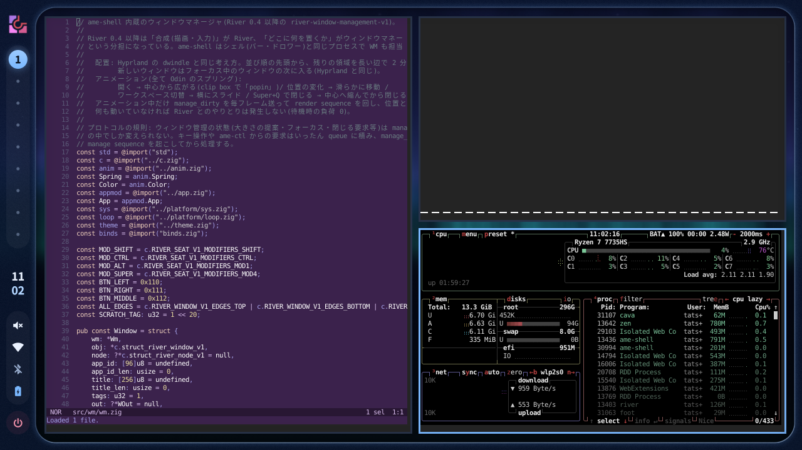
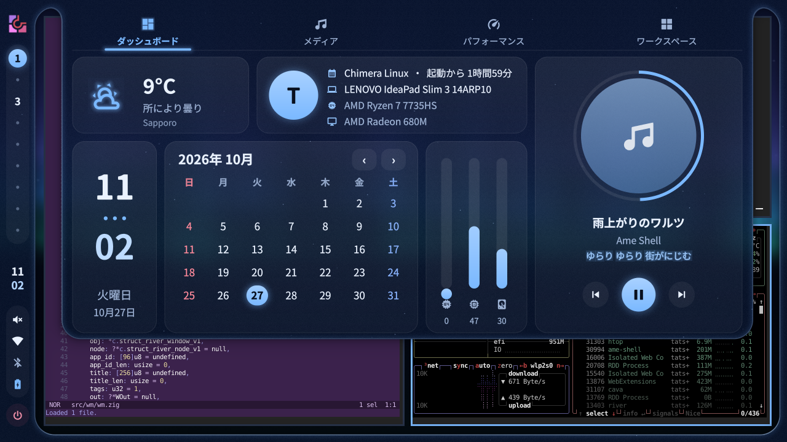
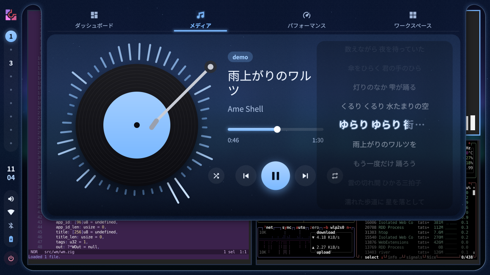
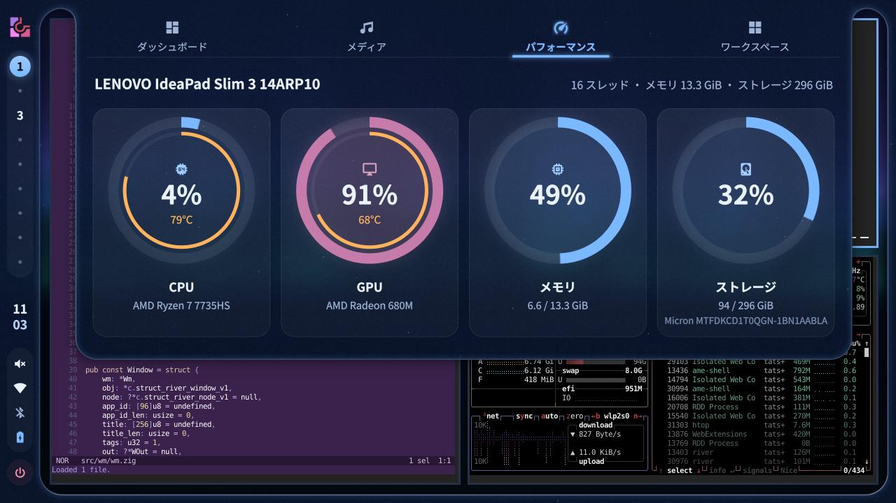
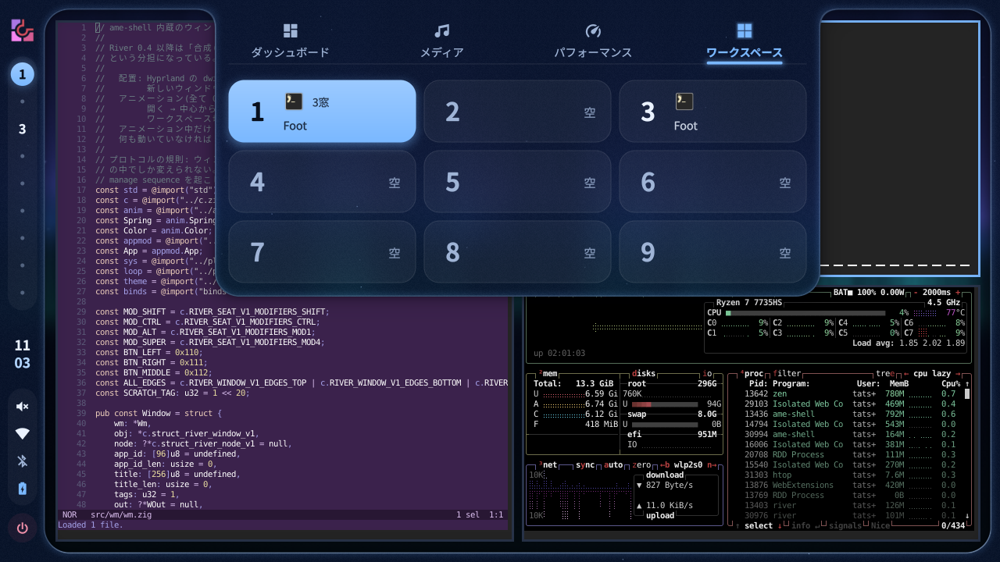
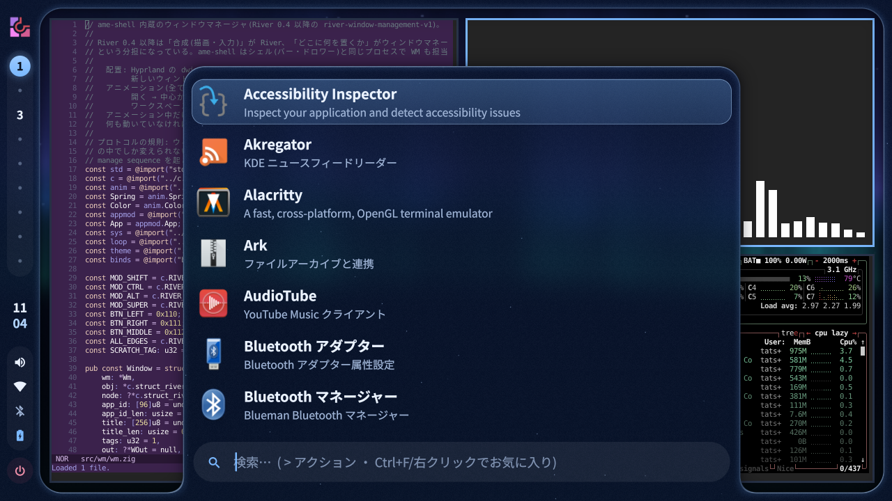
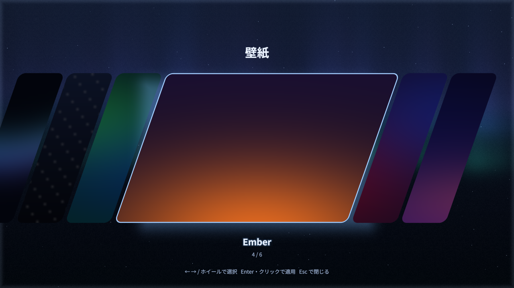
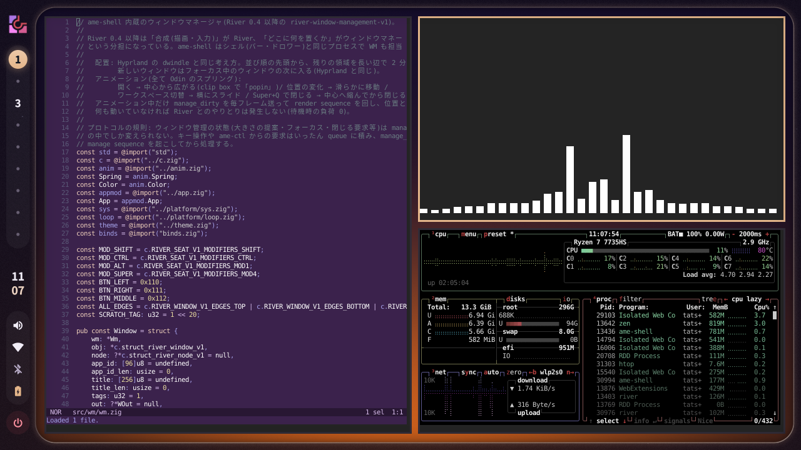
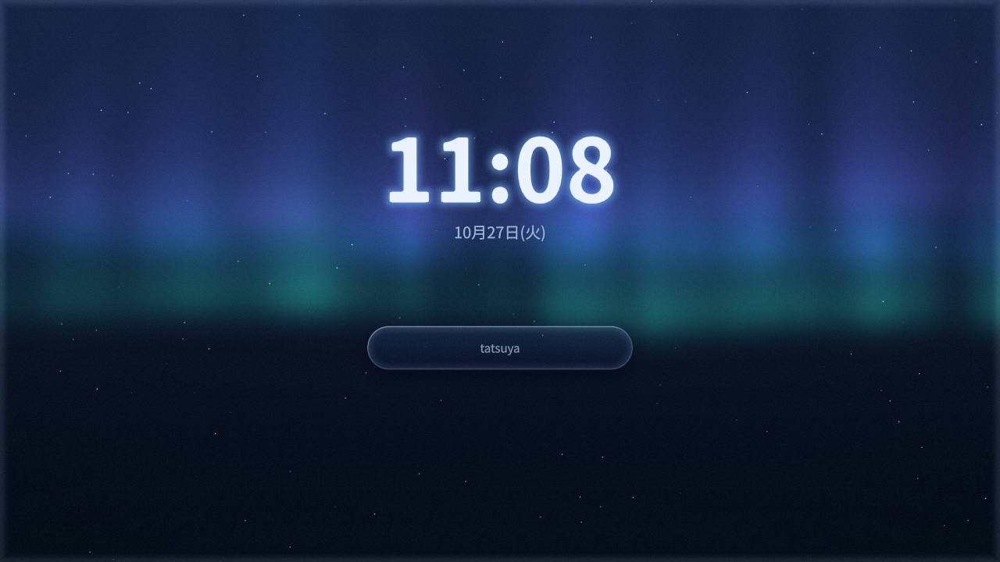

# ame-shell(雨)

[River](https://isaacfreund.com/software/river/)(Wayland コンポジタ)の上で動く、アニメーション重視のガラス調デスクトップシェル。
caelestia-shell・end-4・ilyamiro の雰囲気を目指しつつ、Quickshell / QML / Qt / Python / C++ を使わず **Zig・Odin・C・WebAssembly** だけで書いています。
Chimera Linux(musl + dinit)向け。SDDM から選べるセッションつき。



| | |
|---|---|
|  |  |
|  |  |
|  |  |
|  |  |

## 特徴

### 画面のふちから生えるドロワー(caelestia 風)
画面を細い枠が囲み、左に縦バー。枠の縁にカーソルを乗せると、そこからドロワーが「ニョキッ」と生えてきます(枠とドロワーは 1 つの SDF シェーダで smooth-min 融合しているので、付け根に丸みのある首ができる)。

- **上: ダッシュボード** — 4 つのタブ
  - ダッシュボード: 天気・機種/CPU/GPU 名・ユーザーの写真(クリックで選べる)・カレンダー・メディア
  - メディア: 回るレコードと cava のスペクトラム、トーンアーム、曲名・アーティスト・**アルバム名**、**同期歌詞**(LRCLIB から自動取得、カラオケ風に塗られる、**行をクリックするとその時間へ**)
    - プレーヤーが歌詞を持っている場合は `$XDG_RUNTIME_DIR/lyrics/<MPRIS のプレーヤー名>.lrc`(`[ti:]` `[ar:]` `[al:]` つきの LRC)に置くと、LRCLIB より優先して使います。曲が変わったら書き換えるか消してください
  - パフォーマンス: CPU / GPU / メモリ / ストレージの円グラフ(CPU・GPU は温度つき)
  - ワークスペース: 1〜9 と、それぞれで**開いているアプリのアイコンと名前**
- **下: ランチャー** — Super 単独・Super+D。ファジー検索、よく使う順、お気に入りの固定、全アイコンテーマ + SVG。`>` でアクション、`>壁紙` で壁紙
- **右: 音量・明るさ(OSD)/ 通知 / ユーティリティ / セッション / 通知センター**
- **縦バー** — タグ(液体のように伸びるインジケータ)・時計・音量・ネット・Bluetooth・電池。乗せると右にポップアウト
  - 音量のポップアウトで **出力先・入力先を切り替え**(再生中の音も移る)
  - ネット / Bluetooth をクリックすると **Wi-Fi・Bluetooth の設定パネル**(接続・切断・パスワード・スキャン。外側をクリックで閉じる)。イヤホンは接続すると自動で音の出力先になる

### River 0.5 では本物のウィンドウアニメーション
River 0.5 は「描画は River、配置はウィンドウマネージャ」という分担です。ame-shell がそのウィンドウマネージャを兼ねます(`src/wm/`)。
- Hyprland の **dwindle** 配置、ワークスペース 1〜9、新しい窓はフォーカス中の窓の次へ
- **開く**: 中心から広がる / **移動・並べ替え**: なめらかに動く / **ワークスペース切替**: 横にスライド / **閉じる**: 縮んでから閉じる(すべてスプリング)
- 動いているときだけ毎フレーム更新し、止まっていれば River との通信も 0
- ame-shell を再起動しても窓のワークスペースは保たれる

River 0.3 のセッションでも、シェル部分(ドロワー・壁紙・ランチャーなど)はそのまま使えます。

### 壁紙と配色
- **ライブ壁紙**: シェーダで描くオーロラ / 雨、**GIF・MP4 などの動画**(libmpv を実行時に読み込み、ハードウェア復号)、画像
- **壁紙ピッカー**(Super+Shift+W): 斜めのカードが並び、決定するとカードの位置から円・斜めワイプ・短冊で切り替わる
- **壁紙の置き場**: `~/Pictures/wallpapers`・`~/.config/ame-shell/wallpapers`・`~/.local/share/ame-shell/wallpapers`・`<prefix>/share/ame-shell/wallpapers`(同じ名前は 1 つにまとめる)。インストーラと ame-update は、追加の壁紙を非公開リポジトリ(`AME_WALLPAPERS_REPO` で変更、空で無効)から取ってきます。GitHub にログインしていない場合は案内を出すだけです(`gh auth login && gh auth setup-git`)
- **配色は壁紙から自動**: 壁紙の一番鮮やかな色からアクセント、ガラス・文字色も合わせてなめらかに遷移。再生中はアルバムアートの色に。くすんだ緑や、エラーと紛らわしい赤は避ける
- **エラーは赤**: Wi-Fi の接続失敗などでは枠の縁が一瞬赤く光る
- **ガラス**: 壁紙を dual Kawase でぼかし、パネルは真後ろをサンプル(屈折・色収差・ハイライト)

### そのほか
- 通知サーバ内蔵(`org.freedesktop.Notifications`。他のデーモンが動いていれば譲る)
- ロック画面(Super+L、ext-session-lock + PAM)
- WASM ウィジェット(保存すると状態を保ったままホットリロード)
- `ame-ctl` でシェルを操作(キーバインドやスクリプトから)

## インストール

```sh
git clone https://github.com/TatsuyaM2667/ame-shell && cd ame-shell
sh install.sh            # 全ユーザー用(/usr/local + SDDM のセッション)。root 権限は doas / sudo で自動的に
sh install.sh --user     # 自分だけ(~/.local)。root 不要。SDDM には出ないので TTY から ame-session --river5 で起動
sh install.sh --uninstall [--user]
```

`install.sh` が依存パッケージ(Chimera Linux は自動。他のディストリは足りないものを表示)、Zig 0.13、Odin、River(無ければ River 0.5 をソースから)、ame-shell のビルドとインストールまで行います。
どのユーザーが実行しても構いません。doas / sudo が使えない人は自動で `--user` になります。全ユーザー用では、自分でビルドした River 0.5(`~/.local/opt/river-0.5`)も `/usr/local/opt` にコピーされ、他のアカウントからも River 0.5 のセッションが使えます。
foot は自分の `~/.config/foot/foot.ini` が無ければ、ame-shell の半透明の設定(`data/xdg/foot/foot.ini`)で開きます。

### 画面の拡大率・端末
- **拡大率は自動**(River 0.5 のセッション、`wlr-randr` を使用): 画素の細かさを作者の環境(14 インチ 1920x1200、拡大率 1)と比べて 0.25 刻みで決めます。ふつうの画面は 1 のまま、14 インチ 2880x1800 なら 1.5、13 インチ 4K なら 2。
  自分で決めるときは `~/.config/ame-shell/output-scale` に `1.5` や `eDP-1 1.5`(画面ごと)、`off` で自動設定なし。
- **foot**: 自分の `~/.config/foot/foot.ini` が無ければ ame-shell の設定(半透明、JetBrains Mono 12pt、`dpi-aware=no`)。開くと最初に `fastfetch` を表示します(`AME_FASTFETCH=0` で無効。シェルの設定で自分で呼んでいる場合は二重にしません)。
- カーソルは未設定なら 24px(Adwaita)。

### アップデート(ame-update)

```sh
ame-update            # OS のパッケージ(FreeBSD は pkg、Chimera は apk)→ ame-shell(git pull → ビルド → インストール)→ 再起動
ame-update --check    # 更新があるかを見るだけ
ame-update --no-pkg   # ame-shell だけ(--no-self でパッケージだけ)
```

ランチャーで `>` → 「アップデート」からも実行できます(端末が開きます)。root が必要な作業は doas → sudo → su の順に使える方で行います。
ソースに手元の変更があるときは `git pull` をせず、今のソースでビルドします。動いている ame-shell は新しい版で起動し直します(窓とワークスペースはそのまま)。

### FreeBSD(14 / 15、amd64)

```sh
pkg install -y git && git clone https://github.com/TatsuyaM2667/ame-shell && cd ame-shell
sh install.sh            # = sh scripts/install-freebsd.sh(完全自動)
```

パッケージ(River・SDDM・Xorg・Wayland・フォント・日本語入力)、GPU ドライバ(amdgpu / i915kms / nvidia-drm を自動判別)、dbus / seatd / sddm の有効化、video グループ、
Zig 0.13 と Odin のソースからのビルド(FreeBSD 向けの配布物が無いため、30 分〜1 時間ほど)、ame-shell のビルドとインストールまで行います。終わったら再起動すると SDDM に「Ame Shell」が出ます。
オプション: `--no-gpu`・`--no-ja`・`--no-super-tap`・`--jobs N`・`--yes`(`sh scripts/install-freebsd.sh --help`)。

FreeBSD での違い:
- FreeBSD の `river` パッケージは 0.4 以降なので、ame-shell がウィンドウマネージャを兼ねるセッション(ウィンドウアニメーションつき)だけになります
- 電池・CPU・メモリ・温度は sysctl、音量は PipeWire が無ければ `mixer(8)`、明るさは `backlight(8)`、機種名は SMBIOS(kenv)から
- ロックは setuid で入る `swaylock` を使います(FreeBSD の pam_unix は root でないとパスワードを照合できないため)
- Wi-Fi / Bluetooth の設定パネルは NetworkManager / BlueZ が無いので使えません(パネルにその旨を表示)

### 手動でビルドする

必要: Zig 0.13、Odin、wayland-scanner、wayland / EGL / GLESv2 / xkbcommon / freetype / harfbuzz / fontconfig / dbus の開発ファイル(FreeBSD は加えて libepoll-shim・libinotify)。
実行時に使うもの: `playerctl`・`wpctl` / `pactl`(PipeWire)・`nmcli`・`bluetoothctl`・`curl`・`cava`(任意)・`libmpv`(動画壁紙、任意)・`ffmpeg`(動画のサムネイル、任意)。

```sh
zig build -Doptimize=ReleaseFast     # zig-out/bin/{ame-shell,ame-ctl}, zig-out/share/ame-shell/
zig build test
sh session/install-session.sh        # インストールだけ(--user / --dry-run / --destdir DIR も可)
# Linux から FreeBSD 向けに試しビルド: zig build -Dtarget=x86_64-freebsd --sysroot <FreeBSD の root> --libc <libc.txt>
```

### セッション

SDDM に 3 つのセッションが追加されます(River 0.4 以降しか無いシステムでは「Ame Shell」1 つ):

| セッション | 内容 |
|---|---|
| **Ame Shell (River 0.5)** | ame-shell がウィンドウマネージャを兼ねる。ウィンドウアニメーションあり。River 0.5(`/usr/local/opt/river-0.5`・`~/.local/opt/river-0.5`・PATH の River 0.4 以降)|
| **Ame Shell** | River 0.3 + ame-shell |
| **Ame Shell (Safe Mode)** | River 0.3 + foot だけ(問題が起きたときの脱出口)|

入るものは `/usr/local/share/ame-shell/installed-files`(自分用は `~/.local/share/ame-shell/installed-files`)に記録され、`sh install.sh --uninstall` で元に戻せます。
ログは `~/.local/state/ame-shell/session.log`。起動直後に 3 回続けて落ちると、次回は自動でセーフモードになります。

インストールせずに試す(今のセッションの中にウィンドウとして開く):
```sh
PATH=$PWD/zig-out/bin:$PATH AME_SESSION_NESTED=1 session/ame-session --river5
```

### Bluetooth イヤホン(AirPods など)が繋がらないとき
`br-connection-refused` で繋がらない・すぐ切れる場合は、`doas sh session/bt-airpods-fix.sh` で BlueZ を従来の Bluetooth(BR/EDR)接続に切り替えてから、ペアリングし直してください(`--undo` で元に戻せます)。

音が電話のようにガサガサになるのは、アプリがマイクを開いた瞬間に通話用(HFP、モノラル 16kHz)に切り替わるためです。設定パネルから接続すると、この自動切り替えを止めます(`wpctl settings --save bluetooth.autoswitch-to-headset-profile false`)。通話でイヤホンのマイクを使うときは、音量のポップアウトで入力をイヤホンに切り替えてください。

## キー操作(River 0.5 セッション)

| キー | 動作 |
|---|---|
| Super(単独で押して離す)/ Super+D | ランチャー |
| Super+Return / Super+T | foot |
| Super+A / Super+N / Super+U | ダッシュボード / 通知センター / ユーティリティ |
| Super+Escape | セッション(ロック・ログアウト・再起動・電源オフ。危険な操作は 2 回押し)|
| Super+L | ロック |
| Super+Shift+W | 壁紙ピッカー |
| Super+Q / Super+F / Super+Space | 閉じる / 全画面 / フロート |
| Super+J・K / Super+Shift+J・K | フォーカス / 入れ替え |
| Super+Ctrl+H・L | 左右の比率 |
| Super+1〜9 / Super+Shift+1〜9 / Super+Alt+1〜9 | ワークスペース切替 / 窓を移動 / 窓を移動して自分も移る |
| Super+Ctrl+1〜9 | ワークスペースの表示を足す |
| Super+P / Super+Shift+P | スクラッチパッド |
| Super+ドラッグ(左 / 右)/ Super+中クリック | 移動 / 大きさ変更 / フロート |
| Print / Shift+Print | 範囲 / 全画面のスクリーンショット(~/Pictures/Screenshots + クリップボード)|
| 音量・明るさ・メディアキー | OSD つき |
| Super+Shift+E | セッションを終了 |

River 0.3 セッションのキーは `session/ame-river-init`(追加設定は `~/.config/ame-shell/river-extra.sh`)。

## 設定

`~/.config/ame-shell/config.ame`(無ければ `share/ame-shell/config.ame`)。**保存した瞬間に反映**されます。

```
shell {
  layout caelestia              // caelestia | classic(上部の横バー)
  ui-scale 1.25
  super-launcher on
  weather-location "Sapporo"    // 省略すると IP アドレスから推定
}
theme {
  auto-color on                 // 壁紙から配色を作る
  media-accent on               // 再生中はアルバムアートの色に
  blur 3
}
wallpaper {
  mode aurora                   // aurora | rain | image
  // image "~/Videos/rain.mp4"  // 画像・GIF・動画
  transition random             // ripple | circle | slant | shards | random
  fps 30
  battery-fps 12
}
```
全項目は `data/config.ame` を参照。

## ame-ctl

```
ame-ctl launcher toggle|open [検索語]|close
ame-ctl dashboard toggle|open|close|dashboard|media|performance|workspaces
ame-ctl network | bluetooth | wallpaper-picker | session | sidebar | utilities | close-all
ame-ctl volume up|down|mute|<0-100>      ame-ctl brightness up|down
ame-ctl wallpaper aurora|rain|<画像・GIF・動画のパス>
ame-ctl accent '#ff88aa'|reset           ame-ctl notify <テキスト>
ame-ctl workspace <1-9>                  ame-ctl window close|fullscreen|float|focus-next|…(River 0.5)
ame-ctl lock | reload | widgets reload | stats | restart | quit
```

## WASM ウィジェットを書く

`widgets/*.zig` を参照。`widgets/ame.zig`(SDK)の `rect/grad/glass/text/arc/art` で描画命令を積み、`ame.store` から時刻・システム・メディアの値を読みます。`zig build` で `share/ame-shell/widgets/*.wasm` に出力され、`~/.config/ame-shell/widgets/` に同名の `.wasm` を置くとそちらが優先されます。保存すると状態を保ったまま差し替わります。

## 既知の問題

- ウィンドウの開閉アニメーションは River 0.5 セッションのみ(River 0.3 には外から窓を動かす手段が無い)。ウィンドウ越しのガラスは未対応。
- River 0.3 では、ワークスペースごとのアプリ名は推測(River 0.3 は窓とタグの対応を外に出さない)。
- ランチャーの日本語入力(IME)とトレイは未対応。
- 動画壁紙は再生中に CPU 約 5%(720p)・メモリ +130MB 程度を使う。
- 詳細は `docs/blockers.md`、計測値は `docs/perf.md`。

## ドキュメント

`docs/architecture.md`(構成)・`docs/decisions.md`(設計判断と理由)・`docs/perf.md`(実測)・`docs/reference-analysis.md`(参考シェルの分析)・`docs/progress.md`(進捗)

## ライセンス

GPL-3.0(`LICENSE`)。同梱のサードパーティ: wasm3(MIT、`third_party/wasm3/LICENSE`)、stb_image(MIT / パブリックドメイン)、nanosvg(zlib)。`protocol/` の XML は各プロトコルのライセンスに従います。
スクリーンショットの壁紙はシェーダと ffmpeg で生成したもの、歌詞は説明用に書いたオリジナルです。
